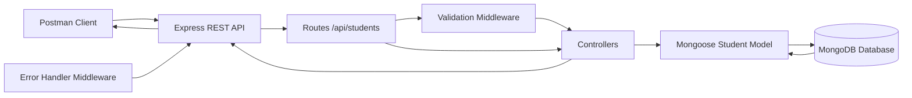

<div align="center">

# Mehran University of Engineering and Technology

## Shaheed Zulfiqar Ali Bhutto Campus, Khairpur Mir's

### Department of Software Engineering

<br><br>

# SW426 — Software Quality Engineering

## Problem Based Learning (PBL) Assignment

### Creating & Testing Backend API using Postman for CRUD Operations

<br><br>

| | |
|---|---|
| **Student Name** | Shahbaz Raza |
| **Roll Number** | K22SW035 |
| **Batch** | K22SW |
| **Semester** | 8th Semester |
| **Course** | SW426 - Software Quality Engineering |
| **Instructor** | Engr. Asmatullah Zubair |
| **Assignment Date** | 10 October 2026 |
| **Due Date** | 11 November 2026 |
| **Assessment Marks** | 10 |

<br><br>

**Submission Date:** 27 October 2026

</div>

<div style="page-break-after: always;"></div>

---

## Table of Contents

1. [Introduction](#1-introduction)
2. [Problem Statement](#2-problem-statement)
3. [Project Objectives](#3-project-objectives)
4. [Description of the Chosen Entity](#4-description-of-the-chosen-entity)
5. [Tools and Technologies](#5-tools-and-technologies)
6. [System Architecture and Project Structure](#6-system-architecture-and-project-structure)
7. [Database Design and Schema](#7-database-design-and-schema)
8. [API Endpoint Documentation](#8-api-endpoint-documentation)
9. [Implementation Details](#9-implementation-details)
10. [Project Setup and Execution](#10-project-setup-and-execution)
11. [API Testing Using Postman](#11-api-testing-using-postman)
12. [Error Handling and Validation](#12-error-handling-and-validation)
13. [Results and Discussion](#13-results-and-discussion)
14. [Problems Encountered and Solutions](#14-problems-encountered-and-solutions)
15. [Learning Outcomes](#15-learning-outcomes)
16. [Conclusion](#16-conclusion)
17. [References](#17-references)
18. [GitHub Repository and Presentation Video](#18-github-repository-and-presentation-video)

---

## 1. Introduction

Software Quality Engineering emphasizes not only building software correctly, but also verifying that it behaves as specified under both normal and abnormal conditions. This Problem-Based Learning (PBL) assignment requires designing, implementing, and testing a **database-connected REST API** that manages records of a selected entity using **JSON** over HTTP and validating behavior with **Postman**.

**CRUD** (Create, Read, Update, Delete) operations form the core of most data-driven applications:

| Operation | HTTP mapping (this project) | Purpose |
|-----------|----------------------------|---------|
| **Create** | `POST /api/students` | Insert a new student record |
| **Read** | `GET /api/students`, `GET /api/students/:id` | List or fetch records |
| **Update** | `PUT /api/students/:id` | Modify an existing record |
| **Delete** | `DELETE /api/students/:id` | Remove a record |

In this implementation, **JSON** is used for request and response bodies. **HTTP status codes** (for example `201 Created`, `200 OK`, `400 Bad Request`, `404 Not Found`, `409 Conflict`) communicate outcome to clients. **MongoDB** provides **persistence** so data remains after the Node.js server restarts. **Postman** is used to send requests, inspect responses, and run automated checks via test scripts in the collection.

The implemented project is a **Student Records REST API** built with **Node.js**, **Express.js**, and **Mongoose**, with sample data centered on **Shahbaz Raza (K22SW035)**.

---

## 2. Problem Statement

The official PBL problem requires the student to **design, develop, and test** a **database-connected REST API** for managing records of a selected entity. The API must:

- Support all four **CRUD** operations.
- Exchange data in **JSON** format.
- Be tested using **Postman** to verify functionality, **HTTP response status codes**, **data accuracy**, and **error handling**.

This report documents the actual implementation and testing evidence available in the project repository, distinguishing **implemented behavior** from **verified test results**.

---

## 3. Project Objectives

The following objectives guided the project work:

1. Develop a REST API using **Node.js** and **Express.js** (ES modules).
2. Integrate **MongoDB** with **Mongoose** for persistent storage.
3. Implement full **CRUD** for the **Student** entity.
4. Use **JSON** for request and response payloads.
5. Return appropriate **HTTP status codes** for success and failure.
6. Validate input and handle errors through centralized middleware.
7. Test successful and unsuccessful scenarios using the **Postman collection** and **automated Node.js tests**.
8. Verify persistence and document outcomes honestly (including tests not yet executed in the Postman GUI).

---

## 4. Description of the Chosen Entity

### 4.1 Rationale for selecting Student records

**Student records** are a natural fit for a university lab: they map directly to real academic attributes (name, roll number, department, semester), require **unique identification** (roll number), and support clear validation rules (semester range). They also align with the batch context (**K22SW**) and the student’s own enrollment data used as primary sample input.

### 4.2 Primary sample record

| Field | Value |
|-------|--------|
| Name | Shahbaz Raza |
| Roll Number | K22SW035 |
| Department | Software Engineering |
| Semester | 8 |

### 4.3 Schema summary (verified from `backend/models/Student.js`)

| Field | Data type | Purpose | Validation constraints |
|-------|-----------|---------|------------------------|
| `name` | String | Student full name | Required; trimmed; minimum length 1 (non-empty) |
| `rollNo` | String | Unique institutional roll number | Required; trimmed; **unique**; minimum length 1 |
| `department` | String | Academic department | Required; trimmed; minimum length 1 |
| `semester` | Number | Current semester | Required; integer; **1–8** inclusive |
| `_id` | ObjectId | Primary key (MongoDB) | Auto-generated; not accepted in create/update body |
| `createdAt` | Date | Record creation time | Auto (`timestamps: true`) |
| `updatedAt` | Date | Last modification time | Auto (`timestamps: true`) |

When documents are serialized to JSON, the schema also exposes a string **`id`** mirroring `_id` (via `toJSON` transform).

### 4.4 Roll number and record ID

- **`rollNo`** is a **business unique key** enforced at the application and database level (Mongoose `unique: true`, MongoDB unique index). Duplicate roll numbers result in **409 Conflict**.
- **`_id`** is the **MongoDB ObjectId** used in URLs (`/api/students/:id`). It is generated by the database and must not be supplied or modified through the public update API (forbidden fields are rejected in validation middleware).

---

## 5. Tools and Technologies

| Technology | Role in this project | Verified in project |
|------------|----------------------|---------------------|
| **Node.js** (≥18) | JavaScript runtime; built-in `node:test` runner | `package.json` `engines`, `"type": "module"` |
| **Express.js** ^4.21.2 | HTTP server, routing, JSON body parsing | `backend/app.js`, `backend/server.js` |
| **JavaScript (ES modules)** | Application language | `import`/`export` throughout `backend/` |
| **MongoDB** | Document database | Connection via `MONGODB_URI` |
| **Mongoose** ^8.9.5 | ODM, schema, validation | `backend/models/Student.js` |
| **dotenv** ^16.4.7 | Environment configuration | `backend/server.js`, tests |
| **Postman** | Manual/API collection testing | `postman/*.json` |
| **Git / GitHub** | Version control (prepared) | `.gitignore` present; **no git repository initialized at report time** |

No React frontend or additional frameworks are used, consistent with the assignment scope.

---

## 6. System Architecture and Project Structure

### 6.1 Data flow

The request path matches the implemented layered structure:



**Flow (text):** Postman Client → Express REST API → Routes and Controllers → Validation and Error Handling → Mongoose Model → MongoDB Database → JSON Response to Postman.

### 6.2 Project folders and files

| Path | Purpose |
|------|---------|
| `backend/config/db.js` | MongoDB connection and disconnect helpers |
| `backend/models/Student.js` | Student schema and model |
| `backend/controllers/studentController.js` | CRUD handler functions |
| `backend/routes/studentRoutes.js` | Maps HTTP methods to controllers and middleware |
| `backend/middleware/validateStudent.js` | Request body validation |
| `backend/middleware/errorHandler.js` | JSON syntax errors, 404 routes, centralized errors |
| `backend/app.js` | Express app configuration (no listen) |
| `backend/server.js` | Loads `.env`, connects DB, listens on `PORT` |
| `backend/tests/` | Automated integration tests (`node:test`) |
| `postman/` | Postman collection and environment JSON |
| `.env.example` | Sample configuration (no secrets) |
| `README.md` | Setup and API documentation |

[Yahan screenshot ayega: Project folder structure Cursor ya File Explorer mein backend, postman aur report folders ke sath.]

### 6.3 Supplementary endpoint

The implementation includes **`GET /health`** (status **200**) to confirm the API process is running. This is not part of the five CRUD routes but supports deployment verification.

---

## 7. Database Design and Schema

### 7.1 Database and collection names (from configuration)

| Setting | Value (default local) | Source |
|---------|----------------------|--------|
| Connection URI | `mongodb://127.0.0.1:27017/sqe_students` | `.env.example` |
| Database name | **`sqe_students`** | URI path segment |
| Test database | **`sqe_students_test`** | `MONGODB_URI_TEST` in `.env.example` |
| Collection name | **`students`** | Mongoose default pluralization of model `Student` |

Atlas deployment is supported by replacing `MONGODB_URI` with a cluster connection string (placeholders only in `.env.example`).

### 7.2 Persistence operations

| CRUD | Mongoose / MongoDB operation |
|------|------------------------------|
| Create | `Student.create()` |
| Read all | `Student.find()` |
| Read one | `Student.findById()` |
| Update | `Student.findByIdAndUpdate(..., { runValidators: true })` |
| Delete | `Student.findByIdAndDelete()` |

[Yahan screenshot ayega: MongoDB Compass mein sqe_students database aur students collection mein saved student document ke fields.]

---

## 8. API Endpoint Documentation

**Verified base URL:** `http://localhost:3000/api/students`  
**Verified default port:** `3000` (`PORT` in `.env.example`, `backend/server.js`)

### 8.1 Create student

| Item | Detail |
|------|--------|
| **Operation** | Create |
| **Method** | `POST` |
| **URL** | `http://localhost:3000/api/students` |
| **Purpose** | Add a new student record |
| **Request body** | JSON with `name`, `rollNo`, `department`, `semester` (all required) |
| **Success status** | **201 Created** |

**Example request:**

```json
{
  "name": "Shahbaz Raza",
  "rollNo": "K22SW035",
  "department": "Software Engineering",
  "semester": 8
}
```

**Example success response (201):**

```json
{
  "success": true,
  "message": "Student created successfully",
  "data": {
    "_id": "674abc1234567890abcdef01",
    "name": "Shahbaz Raza",
    "rollNo": "K22SW035",
    "department": "Software Engineering",
    "semester": 8,
    "createdAt": "2026-10-27T10:00:00.000Z",
    "updatedAt": "2026-10-27T10:00:00.000Z"
  }
}
```

**Error cases:** missing/invalid fields → **400**; duplicate `rollNo` → **409**; invalid JSON → **400**.

---

### 8.2 Retrieve all students

| Item | Detail |
|------|--------|
| **Method** | `GET` |
| **URL** | `http://localhost:3000/api/students` |
| **Success status** | **200 OK** |
| **Body** | None |

**Example success response (200):**

```json
{
  "success": true,
  "count": 1,
  "data": [
    {
      "_id": "674abc1234567890abcdef01",
      "name": "Shahbaz Raza",
      "rollNo": "K22SW035",
      "department": "Software Engineering",
      "semester": 8,
      "createdAt": "2026-10-27T10:00:00.000Z",
      "updatedAt": "2026-10-27T10:00:00.000Z"
    }
  ]
}
```

Empty database returns `"count": 0` and `"data": []`.

---

### 8.3 Retrieve one student by ID

| Item | Detail |
|------|--------|
| **Method** | `GET` |
| **URL** | `http://localhost:3000/api/students/:id` |
| **Success status** | **200 OK** when found |
| **Errors** | Malformed ID → **400**; valid ID, no document → **404** |

**Example success response (200):**

```json
{
  "success": true,
  "data": {
    "_id": "674abc1234567890abcdef01",
    "name": "Shahbaz Raza",
    "rollNo": "K22SW035",
    "department": "Software Engineering",
    "semester": 8,
    "createdAt": "2026-10-27T10:00:00.000Z",
    "updatedAt": "2026-10-27T10:00:00.000Z"
  }
}
```

**400 vs 404:** A syntactically invalid ObjectId (for example `not-a-valid-mongo-id`) yields **400** with message `Invalid student ID format`. A well-formed ObjectId with no matching document (for example `507f1f77bcf86cd799439011`) yields **404** with `Student not found`.

---

### 8.4 Update student

| Item | Detail |
|------|--------|
| **Method** | `PUT` |
| **URL** | `http://localhost:3000/api/students/:id` |
| **Body** | One or more of: `name`, `rollNo`, `department`, `semester` |
| **Success status** | **200 OK** |

**Example request:**

```json
{
  "name": "Shahbaz Raza",
  "rollNo": "K22SW035",
  "department": "Software Engineering",
  "semester": 7
}
```

**Example success response (200):**

```json
{
  "success": true,
  "message": "Student updated successfully",
  "data": {
    "_id": "674abc1234567890abcdef01",
    "name": "Shahbaz Raza",
    "rollNo": "K22SW035",
    "department": "Software Engineering",
    "semester": 7,
    "createdAt": "2026-10-27T10:00:00.000Z",
    "updatedAt": "2026-10-27T11:00:00.000Z"
  }
}
```

**Errors:** **404** if student missing; **400** for validation; **409** for duplicate roll number; **400** if `_id` or other forbidden fields are sent.

---

### 8.5 Delete student

| Item | Detail |
|------|--------|
| **Method** | `DELETE` |
| **URL** | `http://localhost:3000/api/students/:id` |
| **Success status** | **200 OK** (with confirmation message) |

**Example success response (200):**

```json
{
  "success": true,
  "message": "Student deleted successfully",
  "data": {
    "id": "674abc1234567890abcdef01"
  }
}
```

Subsequent `GET` on the same ID must return **404**.

---

## 9. Implementation Details

### 9.1 Database connection

`backend/config/db.js` reads `MONGODB_URI`, connects with Mongoose, and logs the connected database name. `backend/server.js` calls `connectDB()` before `app.listen()`.

### 9.2 Student model

The schema in `backend/models/Student.js` defines required fields, trimming, semester bounds (1–8), and unique `rollNo`.

### 9.3 Routes and controllers

Routes in `backend/routes/studentRoutes.js`:

- `POST /` → validate (full body) → `createStudent`
- `GET /` → `getAllStudents`
- `GET /:id` → validate ObjectId → `getStudentById`
- `PUT /:id` → validate ObjectId → validate (partial) → `updateStudent`
- `DELETE /:id` → validate ObjectId → `deleteStudent`

Controllers in `backend/controllers/studentController.js` perform Mongoose operations and wrap results in `{ success, message?, data }` JSON.

### 9.4 Request parsing and validation

- `express.json()` parses JSON bodies (`backend/app.js`).
- `validateStudentBody` enforces types, emptiness, semester range, allowed fields, and blocks `_id` updates.
- `validateObjectId` rejects malformed `:id` parameters before database access.

### 9.5 Error handling

- Invalid JSON → `jsonSyntaxErrorHandler` → **400** `Invalid JSON in request body`.
- Unknown routes → `notFoundHandler` → **404**.
- Operational errors → `createHttpError` with `statusCode`.
- Mongoose validation → **400**; duplicate key → **409**.
- Unhandled errors → **500** without stack trace in the response.

**Illustrative excerpt — route registration:**

```14:18:backend/routes/studentRoutes.js
router.post('/', validateStudentBody({ partial: false }), createStudent);
router.get('/', getAllStudents);
router.get('/:id', validateObjectId('id'), getStudentById);
router.put('/:id', validateObjectId('id'), validateStudentBody({ partial: true }), updateStudent);
router.delete('/:id', validateObjectId('id'), deleteStudent);
```

[Yahan screenshot ayega: Cursor mein studentController.js ya validateStudent.js ka relevant code snippet visible ho.]

---

## 10. Project Setup and Execution

Instructions below match `README.md` and `package.json` scripts.

### 10.1 Prerequisites

- Node.js 18 or newer
- MongoDB (local service or Atlas)
- Postman desktop application

### 10.2 Environment configuration

**PowerShell:**

```powershell
cd "C:\Users\ZIA COMPUTERS\Desktop\SQE-CRUD-API"
Copy-Item .env.example .env
```

Edit `.env` (do not commit secrets):

```env
PORT=3000
NODE_ENV=development
MONGODB_URI=mongodb://127.0.0.1:27017/sqe_students
MONGODB_URI_TEST=mongodb://127.0.0.1:27017/sqe_students_test
```

### 10.3 Install dependencies

```powershell
npm install
```

### 10.4 Start MongoDB (local example)

```powershell
net start MongoDB
```

### 10.5 Start the API

```powershell
npm start
```

Expected console output includes `MongoDB connected: sqe_students` and `Server listening on http://localhost:3000`.

### 10.6 Verify server and database

- `GET http://localhost:3000/health` → **200**, `"message": "API is running"` (**verified** on 27 October 2026 during report preparation).
- `GET http://localhost:3000/api/students` → **200** JSON array.

[Yahan screenshot ayega: Cursor terminal mein server aur MongoDB connection ka successful message.]

[Yahan screenshot ayega: Browser ya Postman mein /health endpoint ka 200 OK JSON response.]

---

## 11. API Testing Using Postman

### 11.1 Collection and environment

| File | Purpose |
|------|---------|
| `postman/SW426 Student CRUD API.postman_collection.json` | All CRUD and error scenarios with test scripts |
| `postman/SW426 Local Environment.postman_environment.json` | Variables `baseUrl`, `studentId` |

**Import steps:** Postman → **Import** → select both files → activate **SW426 Local Environment**.

**Variables:**

- `baseUrl` = `http://localhost:3000`
- `studentId` = set automatically in test script after successful create (request **1. Create valid student**)

**Run order:** Folder **1. Happy Path (run in order)** must run sequentially so `studentId` is populated. Folder **2. Validation and errors** can run independently (duplicate test uses roll `K26DUP999` with a pre-request seed).

### 11.2 How Postman tests validate behavior

Each request includes **Tests** tab scripts that typically:

- Assert HTTP status with `pm.response.to.have.status(...)`.
- Parse JSON and check `success`, `data`, and field values.
- Save `_id` to `pm.collectionVariables.set('studentId', ...)` after create.

This automates regression checking when the collection runner executes.

[Yahan screenshot ayega: Postman collection aur uski required requests ki list folders ke sath.]

### 11.3 Test case matrix

**Evidence legend:**

- **Automated (`npm test`):** Executed 27 Oct 2026 on `sqe_students_test` — **13/13 passed**.
- **Newman (CLI):** One collection run 27 Oct 2026 against live server on port 3000 and database `sqe_students` — error scenarios mostly passed; happy path failed when `K22SW035` already existed.
- **Postman GUI:** **Not yet tested** (no exported GUI run report or screenshots in the project).

| TC ID | Test case name | Expected result | Actual result (verified evidence) | HTTP status (actual) | Pass/Fail |
|-------|----------------|-----------------|-----------------------------------|----------------------|-----------|
| TC-01 | Create valid student | 201, record returned | **Automated test:** created Shahbaz Raza / K22SW035. **Newman:** 409 duplicate roll (record already in `sqe_students`). **Postman GUI:** Not yet tested | 201 (automated) / 409 (Newman) | **Pass** (automated); **Fail** (Newman happy path on non-empty DB) |
| TC-02 | Retrieve all students | 200, JSON array | **Newman:** 200, array returned. **Automated:** 200 | 200 | **Pass** |
| TC-03 | Retrieve single student | 200, matching `_id` | **Automated:** 200 with correct rollNo. **Newman:** failed (empty `studentId` after TC-01 fail) | 200 (automated) | **Pass** (automated); **Fail** (Newman cascade) |
| TC-04 | Update existing student | 200, updated fields | **Automated:** semester updated to 7. **Newman:** 404 (no valid id in path) | 200 (automated) | **Pass** (automated); **Fail** (Newman cascade) |
| TC-05 | Delete existing student | 200, confirmation | **Automated:** 200 delete success. **Newman:** 404 | 200 (automated) | **Pass** (automated); **Fail** (Newman cascade) |
| TC-06 | Get deleted student | 404 Not Found | **Automated:** 404 after delete. **Newman:** 200 (wrong id / list behavior after cascade) | 404 (automated) | **Pass** (automated); **Fail** (Newman cascade) |
| TC-07 | Missing required fields | 400, validation errors | **Automated & Newman:** 400, `errors` array | 400 | **Pass** |
| TC-08 | Invalid field values | 400 | **Automated & Newman:** 400 (semester 15 / 99) | 400 | **Pass** |
| TC-09 | Duplicate roll number | 409 | **Automated & Newman:** 409 | 409 | **Pass** |
| TC-10 | Malformed student ID | 400 | **Automated & Newman:** 400 | 400 | **Pass** |
| TC-11 | Valid but nonexistent ID | 404 | **Automated & Newman:** 404 | 404 | **Pass** |
| TC-12 | Update nonexistent student | 404 | **Automated & Newman:** 404 | 404 | **Pass** |
| TC-13 | Delete nonexistent student | 404 | **Automated & Newman:** 404 | 404 | **Pass** |
| TC-14 | Invalid JSON body | 400 | **Newman:** 400 `Invalid JSON in request body`. **Automated:** not separately asserted | 400 | **Pass** (Newman); **Not yet tested** (Postman GUI screenshot) |
| TC-15 | Database persistence | Data survives restart; CRUD reflected in DB | **Automated tests** perform real MongoDB CRUD on `sqe_students_test`. **Compass verification:** Not yet tested | N/A | **Partially verified** (automated DB); **Not yet tested** (Compass) |

[Yahan screenshot ayega: Postman mein POST request, JSON body, 201 Created status aur response (fresh database ya naya rollNo ke sath).]

[Yahan screenshot ayega: Postman mein GET request ke zariye tamam students ka JSON response.]

[Yahan screenshot ayega: Postman mein single student retrieve karne ka 200 OK response.]

[Yahan screenshot ayega: Postman mein PUT request aur updated semester ka response.]

[Yahan screenshot ayega: Postman mein DELETE request aur successful deletion ka response.]

[Yahan screenshot ayega: Deleted student ko GET karne par 404 Not Found response.]

[Yahan screenshot ayega: Missing required fields ki request aur actual validation error.]

[Yahan screenshot ayega: Invalid semester value ki request aur 400 validation response.]

[Yahan screenshot ayega: Duplicate roll number ki request aur 409 error response.]

[Yahan screenshot ayega: Malformed ID aur nonexistent ID testing ke actual responses.]

[Yahan screenshot ayega: Invalid JSON body request ka 400 response Postman Tests tab ke sath.]

### 11.4 Automated test summary (Node.js)

Command: `npm test`  
Date: **27 October 2026**  
Database: **`sqe_students_test`**  
Result: **13 tests, 13 passed, 0 failed**

[Yahan screenshot ayega: Terminal mein npm test ka output jisme 13 tests pass dikhen.]

---

## 12. Error Handling and Validation

The application implements the following behaviors (verified in code and/or automated tests):

| Scenario | Handling | Typical status |
|----------|----------|----------------|
| Missing required fields (create) | `validateStudentBody` collects errors | **400** |
| Empty strings after trim | Rejected as empty | **400** |
| Incorrect types (e.g. non-integer semester) | Validation messages | **400** |
| Invalid semester (outside 1–8) | Validation messages | **400** |
| Duplicate roll number | MongoDB error code 11000 mapped | **409** |
| Malformed MongoDB ID in URL | `validateObjectId` | **400** |
| Valid ID, no document | Controller checks null result | **404** |
| Invalid JSON body | `jsonSyntaxErrorHandler` | **400** |
| Unsupported routes | `notFoundHandler` | **404** |
| Database connection failure | Server fails to start (`process.exit(1)`) | N/A at runtime |
| Unexpected server errors | Generic message | **500** (no stack in response) |

Forbidden updates to `_id`, `id`, `__v`, `createdAt`, `updatedAt` return **400**.

Clear JSON errors (`success: false`, `message`, optional `errors` array) support debugging and Postman assertions without exposing credentials or stack traces to clients.

---

## 13. Results and Discussion

### 13.1 Implementation status

All five required CRUD endpoints are **implemented** and registered under `/api/students` on port **3000**, with Mongoose persistence to database **`sqe_students`**.

### 13.2 Testing status

| Test channel | Executed? | Outcome |
|--------------|-----------|---------|
| Node.js automated tests (`npm test`) | Yes (27 Oct 2026) | **13/13 Pass** on isolated test DB |
| Postman collection via Newman CLI | Yes (27 Oct 2026) | **18/27 assertions passed**; happy path **failed** when `K22SW035` already existed |
| Postman GUI with screenshots | **Not yet tested** | Evidence pending |
| MongoDB Compass persistence check | **Not yet tested** | Evidence pending |

### 13.3 CRUD verification (automated evidence)

On **`sqe_students_test`**, the automated suite verified:

- Create returns **201** with correct fields for Shahbaz Raza / K22SW035.
- Read all and read one return **200**.
- Update changes semester and returns **200**.
- Delete returns **200**, followed by **404** on read.

### 13.4 Error handling verification

Automated tests and Newman runs confirmed **400**, **404**, and **409** responses for the scenarios listed in Section 12. Invalid JSON returned **400** in the Newman run.

### 13.5 Limitations

- Running the Postman happy path against a database that **already contains K22SW035** causes **409** on create and breaks dependent requests unless the record is removed or a different roll number is used.
- **GitHub repository** and **presentation video** were not available in the project at report time.
- **Compass screenshots** and **Postman GUI screenshots** are still required for complete submission evidence.

### 13.6 Test count summary (recorded runs only)

| Source | Tests / assertions | Passed | Failed |
|--------|-------------------|--------|--------|
| `npm test` | 13 | 13 | 0 |
| Newman collection assertions | 27 | 18 | 9 |

---

## 14. Problems Encountered and Solutions

| Issue | Cause (verified) | Corrective action | Verification |
|-------|------------------|-------------------|--------------|
| Postman happy path create returns **409** | Student with roll **K22SW035** already present in **`sqe_students`** from earlier runs | Delete the document in Compass or use a new roll number; re-run folder **1. Happy Path** from the top | Newman showed **409** on create; automated tests pass on empty **`sqe_students_test`** |
| `EADDRINUSE` on port 3000 | API already running when second `node backend/server.js` was started | Stop the existing process or use one server instance | Health check succeeded on running instance |
| Newman happy path cascade failures | Empty `studentId` after failed create | Fix TC-01 first so collection variable is set | Dependent requests hit `/api/students/` without id |

No additional undocumented defects were observed in automated testing beyond the data-state dependency above.

---

## 15. Learning Outcomes

This project demonstrates:

1. **REST API design** with resource-oriented URLs and standard HTTP verbs.
2. **HTTP status semantics** (`201`, `200`, `400`, `404`, `409`, `500`).
3. **JSON** as the interchange format for requests and structured responses.
4. **MongoDB integration** with schema validation and persistence.
5. **Input validation** at the middleware layer before database writes.
6. **Centralized error handling** for consistent client responses.
7. **API testing** using Postman collections, scripts, and variables.
8. **Repeatable automated tests** with Node’s built-in test runner on an isolated database.
9. **Technical documentation** via README and this report.
10. **Version-control readiness** through `.gitignore` (repository creation pending).

These outcomes align with **SW426 Software Quality Engineering** emphasis on verification, traceability, and quality of both product and test evidence.

---

## 16. Conclusion

The **Student CRUD REST API** for SW426 PBL was implemented using **Node.js**, **Express.js**, **Mongoose**, and **MongoDB**, with validation and error-handling middleware and a Postman collection covering success and failure scenarios. **Automated integration tests (13/13 passed)** on **`sqe_students_test`** provide strong evidence that CRUD and error paths behave as designed.

**Verified:** API health endpoint, full CRUD on test database, validation and error status codes, Postman collection structure and Newman execution of error scenarios.

**Incomplete / pending:** Postman GUI screenshots, Compass persistence screenshots, GitHub repository URL, presentation video, and a clean full happy-path Postman run on **`sqe_students`** after resolving duplicate **K22SW035** data.

Completing those items will align the submission evidence fully with the assignment checklist.

---

## 17. References

1. Node.js Documentation. *Node.js v18+ Documentation*. https://nodejs.org/docs/latest-v18.x/api/index.html  
2. Express.js. *Express 4.x API Reference*. https://expressjs.com/en/4x/api.html  
3. MongoDB, Inc. *MongoDB Manual*. https://www.mongodb.com/docs/manual/  
4. Mongoose. *Mongoose Documentation*. https://mongoosejs.com/docs/guide.html  
5. Postman. *Postman Learning Center*. https://learning.postman.com/docs/introduction/overview/  
6. Mehran University of Engineering and Technology — **SW426 Software Quality Engineering PBL Assignment**: *Creating & Testing Backend API using Postman for CRUD Operations* (Assignment date: 10 October 2026; Due: 11 November 2026).

---

## 18. GitHub Repository and Presentation Video

| Item | Value |
|------|--------|
| **GitHub Repository URL** | [GitHub Repository URL — To Be Added] |
| **Presentation Video URL** | [Presentation Video URL — To Be Added] |

At report preparation time, **no git repository** was initialized in the project folder and **no verified repository or video links** were found in project files.

The repository should contain the complete source, Postman files, README, and this report. The presentation video should demonstrate:

- Project execution and MongoDB connection  
- All CRUD operations with JSON data and status codes  
- At least one error-handling scenario (for example duplicate roll or validation error)  

[Yahan screenshot ayega: GitHub repository mein project source files push ke baad.]

[Yahan screenshot ayega: Project ki live presentation mein API testing aur execution ka relevant frame.]

---

*End of Report*
